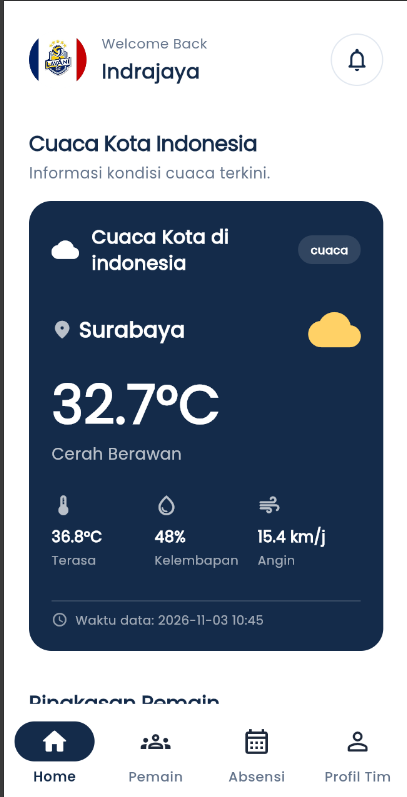
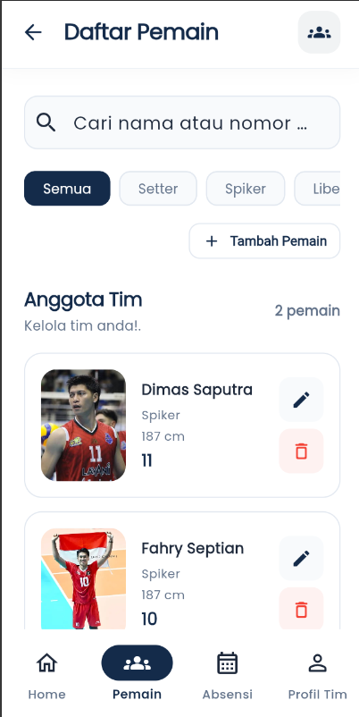
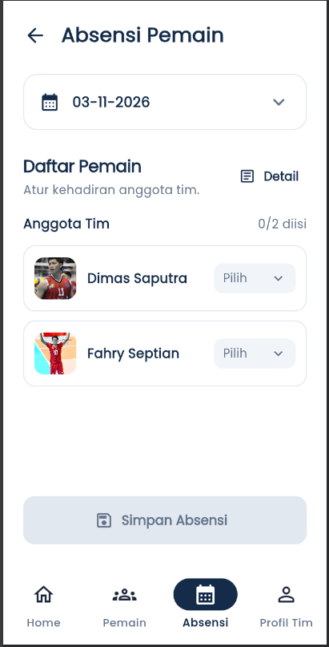
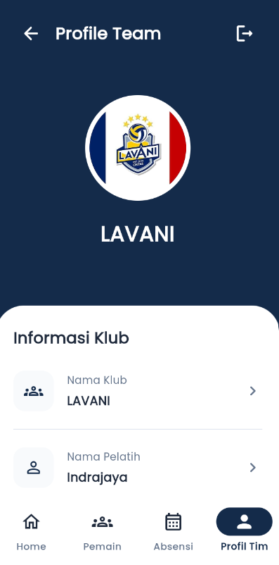

# 🏐 VCLUB — Volleyball Club Management

Aplikasi manajemen klub bola voli berbasis Flutter yang dirancang untuk membantu pengelolaan data pemain, absensi, pemain favorit, dan informasi klub dalam satu platform.

## 👨‍💻 Identitas Pengembang

| Keterangan    | Informasi                          |
| ------------- | ---------------------------------- |
| Nama          | Komang Indrajaya Darmawiguna       |
| NIM           | 2455011001                         |
| Kelas         | TRPL A                             |
| Program Studi | Teknologi Rekayasa Perangkat Lunak |
| Universitas   | Universitas Pendidikan Ganesha     |

## ✨ Fitur Utama

- **Authentication** — Registrasi, login, dan logout akun klub.
- **Dashboard** — Menampilkan informasi utama klub.
- **Manajemen Pemain** — Mengelola data pemain klub.
- **Absensi Pemain** — Mencatat kehadiran pemain.
- **Pemain Favorit** — Menyimpan daftar pemain favorit.
- **Profil Klub** — Menampilkan informasi, nama pelatih, logo, dan daftar pemain favorit.
- **Responsive Layout** — Mendukung tampilan pada berbagai ukuran layar.

## 🛠️ Tech Stack

| Teknologi  | Kegunaan                        |
| ---------- | ------------------------------- |
| Flutter    | Framework pengembangan aplikasi |
| Dart       | Bahasa pemrograman              |
| Supabase   | Backend dan layanan autentikasi |
| PostgreSQL | Database                        |
| Provider   | State management                |
| REST API   | Integrasi data eksternal        |

## 🌐 REST API

VCLUB menggunakan REST API eksternal untuk mendukung pengambilan data:

- **REST Countries API** — Mengambil informasi negara.
- **Open-Meteo API** — Mengambil informasi cuaca.

## 🗄️ Backend & Database

VCLUB menggunakan **Supabase** sebagai Backend-as-a-Service (BaaS), dengan PostgreSQL sebagai database utama.

Layanan yang digunakan:

- Supabase Authentication untuk autentikasi pengguna.
- Supabase Database untuk menyimpan data klub, pemain, dan absensi.
- Supabase Storage untuk penyimpanan logo klub.

## 🏗️ Arsitektur Aplikasi

Aplikasi menerapkan pendekatan pemisahan tanggung jawab dengan Provider, Service, dan Repository.

```text
lib/
├── core/
│   └── theme/
├── models/
├── providers/
├── repositories/
├── services/
├── screens/
│   ├── auth/
│   ├── dashboard/
│   ├── players/
│   ├── attendance/
│   └── profile/
├── widgets/
└── main.dart
```

Alur pengelolaan data:

```text
UI / Screen
    ↓
Provider
    ↓
Repository
    ↓
Service
    ↓
Supabase / REST API
```

## 📸 Screenshot Aplikasi

|                Dashboard                |             Data Pemain             |
| :-------------------------------------: | :---------------------------------: |
|  |  |

|               Absensi               |             Profil Klub             |
| :---------------------------------: | :---------------------------------: |
|  |  |

## 🚀 Cara Menjalankan Project

### 1. Clone Repository

```bash
git clone https://github.com/indrajaya140506/UTS_2455011001_Komang-Indrajaya-Darmawiguna.git
```

### 2. Masuk ke Folder Project

```bash
cd UTS_2455011001_Komang-Indrajaya-Darmawiguna
```

### 3. Install Dependencies

```bash
flutter pub get
```

### 4. Konfigurasi Supabase

Sesuaikan konfigurasi URL dan publishable/anon key Supabase pada project sesuai konfigurasi yang digunakan.

Jangan memasukkan `service_role` key ke dalam aplikasi atau repository publik.

### 5. Jalankan Aplikasi

```bash
flutter run
```

---

**VCLUB** — Simplifying Volleyball Club Management.

Developed by **Komang Indrajaya Darmawiguna**.
